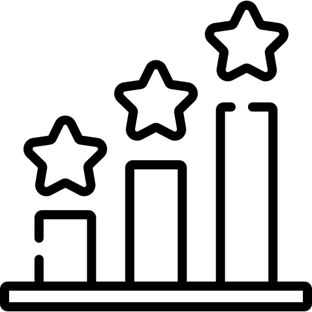
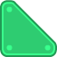
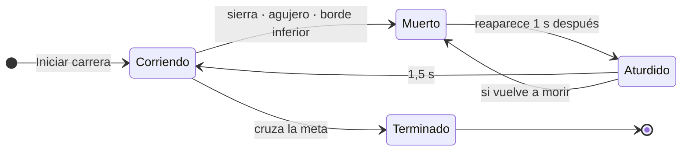
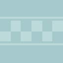

# Hurry to the Top · Manual y Wiki

**Todo lo que hay en la pista, qué te hace y cómo aprovecharlo.**

🏁 1 circuito · 📏 8 100 u de largo · 🧱 39 obstáculos · ✨ 12 zonas · 🤖 3 rivales

[Cómo se juega](#-cómo-se-juega) ·
[Leyenda](#-leyenda) ·
[Obstáculos](#-obstáculos) ·
[Zonas](#-zonas-del-suelo) ·
[Estados](#-estados-del-jugador) ·
[Velocidades](#-tabla-de-velocidades) ·
[Penalizaciones](#-penalizaciones) ·
[El circuito](#-el-circuito-tramo-a-tramo)

---

## 🎮 Cómo se juega

Llega a la meta, arriba de todo, en el **menor tiempo posible**. Tu tiempo final es:

### ⏱️ Tiempo final = tiempo de carrera + penalizaciones

| | Acción |
|:-:|---|
| 🖱️ | **Clic izquierdo** (escritorio) o **toque** (móvil) sobre la pista: tu avatar camina en línea recta hasta ese punto. |
| ✕ | Una **cruz amarilla** marca tu destino hasta que llegas. |
| 🟡 | Tu avatar lleva un **anillo amarillo** para que lo encuentres entre los rivales. |
| 🛑 | Si **chocas**, te detienes: elige un destino nuevo. |

> [!IMPORTANT]
> **La cámara nunca espera.** Sube sola, y si el líder se adelanta, la cámara lo sigue. Quien se queda abajo y toca el borde inferior **muere**, y esa es la muerte que más tiempo cuesta.

**Fases de la partida:** `esperando` → cuenta regresiva de **3 s** → `en carrera` → `terminada`. La carrera termina cuando todos cruzan la meta o al llegar a **3 minutos**. Gana quien tenga el **menor tiempo final**, no necesariamente quien llegó primero.

> [!NOTE]
> **Unidades.** Las distancias van en unidades del mundo (**u**). La pista mide **540 u** de ancho y una pantalla muestra **960 u** de alto, así que el circuito completo mide unas **8,4 pantallas**.

---

## 🧭 Leyenda

| Etiqueta | Significa |
|:-:|---|
| 🔵 **SÓLIDO** | No mata. Te hace **rebotar** y te detiene. |
| 🔴 **MORTAL** | Te **mata**: reapareces 1 s después, aturdido y con penalización. |
| 🟢 **BUFF** | Efecto **positivo**. |
| 🟠 **DEBUFF** | Efecto **negativo**. |
| 🔁 **MÓVIL** | Se mueve en vaivén: mira su ritmo antes de cruzar. |

---

## 🧱 Obstáculos

###  Muro

`🔵 SÓLIDO` · **10 en el circuito**

| Efecto | Valor |
|---|---|
| Rebote | **24 u** hacia atrás |
| Movimiento | Detiene al jugador (hay que hacer clic otra vez) |
| Daño | Ninguno |

**Cómo funciona.** Al chocar, sales por el lado **contrario a tu dirección** que quede **más cerca**. Si ibas hacia arriba a la derecha y rozas la esquina, sales hacia abajo o hacia la izquierda, lo que sea más corto.

> [!TIP]
> Los muros arman **embudos y zigzags**. Mira dónde está el hueco antes de hacer clic: un choque te frena y la cámara sigue subiendo.

---

###  Caja

`🔵 SÓLIDO` `🔁 MÓVIL` · **6 en el circuito, todas móviles**

| Efecto | Valor |
|---|---|
| Rebote | **24 u** |
| Recorrido | Vaivén horizontal de **150 a 200 u** a cada lado |
| Ritmo | Una ida y vuelta cada **2 a 3 s** |

**Cómo funciona.** Igual que un muro, pero se mueve. Si una caja **te alcanza estando quieto**, te empuja fuera por el lado más cercano.

> [!TIP]
> Las cajas de los tramos 6 y 11 van **en pareja y en sentidos opuestos**: cruza cuando se separan.

---

###  Rebotador

`🔵 SÓLIDO` · **4 en el circuito**

| Efecto | Valor |
|---|---|
| Rebote | **48 u** (el doble que un muro) |
| Daño | Ninguno |

**Cómo funciona.** Un muro con resorte: te lanza **el doble de lejos**. Cuidado: ese empujón puede dejarte más cerca del borde inferior.

---

###  Sierra

`🔴 MORTAL` `🔁 MÓVIL` · **9 en el circuito**: 3 fijas, 5 que suben y bajan y 1 que cruza la pista

| Efecto | Valor |
|---|---|
| Mata | Al **rozarla** |
| Penalización | **2 s**, más un 50 % por cada muerte anterior |
| Recorrido (móviles) | **60 a 70 u** en vertical o **190 u** en horizontal |
| Ritmo (móviles) | Una ida y vuelta cada **1,5 a 3,2 s** |

**Cómo funciona.** Basta con tocar el filo para morir. Para que sea justo, la zona mortal es un poco más chica que el dibujo (80 % de su radio), así que los roces con el borde transparente no cuentan.

> [!WARNING]
> La sierra del **tramo 8** cruza **toda la pista** de lado a lado. No te quedes quieto en su línea.

---

###  Agujero

`🔴 MORTAL` · **10 en el circuito**

| Efecto | Valor |
|---|---|
| Mata | Cuando tu **centro** cae dentro |
| Penalización | **2 s**, más un 50 % por cada muerte anterior |

**Cómo funciona.** A diferencia de la sierra, **rozar el borde no mata**: solo caes si el centro de tu avatar entra en el agujero. Puedes pasar pegado a él.

> [!TIP]
> El **campo de agujeros** del tramo 10 se cruza en diagonal, de hueco en hueco.

---

## ✨ Zonas del suelo

###  Plataforma de impulso

`🟢 BUFF` · **6 en el circuito**

| Efecto | Valor |
|---|---|
| Velocidad | **× 1,8** (de 220 a **396 u/s**) |
| Duración | **2 s** desde que la pisas |
| Recarga | Mientras sigas encima, vuelve a 2 s |

**Cómo se ve.** Una **estela amarilla** detrás de tu avatar.

**Cómo funciona.** Se activa cuando tu centro pasa sobre la plataforma. Choques y muertes siguen igual: el impulso no te protege. Si mueres, lo pierdes.

> [!TIP]
> Toma el impulso **justo antes** de un terreno lento: con los dos activos vas a 198 u/s, casi a velocidad normal.

---

###  Terreno lento

`🟠 DEBUFF` · **6 en el circuito**

| Efecto | Valor |
|---|---|
| Velocidad | **× 0,5** (de 220 a **110 u/s**) |
| Duración | Mientras estés dentro; al salir se quita de inmediato |

**Cómo se ve.** Tu avatar se cubre de un **tinte marrón**.

**Cómo funciona.** Afecta a todos por igual y está siempre en el mismo lugar. La decisión es tuya: **¿lo cruzas o lo rodeas?**

> [!CAUTION]
> La franja del **tramo 10** cubre **todo el ancho** de la pista: no se puede rodear.

---

## 🧬 Estados del jugador

| Estado | Efecto | Cómo se ve |
|---|---|---|
| 🏃 **Corriendo** | Se mueve normal | Avatar con su nombre |
| 💀 **Muerto** | No se puede mover durante **1 s** | Un fantasma rojo parpadea en el centro de la cámara, donde va a reaparecer |
| 💫 **Aturdido** `🟠 DEBUFF` | **× 0,4** de velocidad (**88 u/s**) durante **1,5 s** | **Anillo rojo discontinuo** que gira y se achica; el avatar parpadea |
| 🏁 **Terminado** | Ya no compite ni choca | Avatar semitransparente |

> [!NOTE]
> **Dónde reapareces.** En el **centro de la cámara**. Si ese punto está ocupado por otro jugador o por un obstáculo, reapareces en el **punto libre más cercano** de esa misma línea. Así varios jugadores que mueren juntos no aparecen uno encima del otro.

---

## 🚀 Tabla de velocidades

Los efectos se **multiplican**: *velocidad = 220 × impulso × lento × aturdido*.

| Combinación | Velocidad | |
|---|--:|---|
| 🟢 Impulso | **396 u/s** | `██████████████████` |
| ⚪ Normal | **220 u/s** | `██████████` |
| 🟢🟠 Impulso + lento | **198 u/s** | `█████████` |
| 🟢💫 Impulso + aturdido | **158 u/s** | `███████` |
| 🟠 Terreno lento | **110 u/s** | `█████` |
| 💫 Aturdido | **88 u/s** | `████` |
| 🟢🟠💫 Los tres | **79 u/s** | `████` |
| 📷 *Cámara (referencia)* | **60 u/s** | `███` |
| 🟠💫 Lento + aturdido | **44 u/s** | `██` |

> [!WARNING]
> **Aturdido dentro de terreno lento vas más lento que la cámara.** Si reapareces ahí, sal hacia arriba de inmediato.

---

## 💸 Penalizaciones

Cada muerte suma tiempo, y **cada muerte cuesta más que la anterior** (+50 % de la base por cada muerte previa, sin importar la causa).

| Muerte n.º | 📷 Borde inferior | 🔴 Sierra o agujero |
|:-:|:-:|:-:|
| 1.ª | **+5 s** | **+2 s** |
| 2.ª | **+7,5 s** | **+3 s** |
| 3.ª | **+10 s** | **+4 s** |
| 4.ª | **+12,5 s** | **+5 s** |
| 5.ª | **+15 s** | **+6 s** |

Ejemplo: mueres en una sierra (+2 s), luego por el borde (+7,5 s) y luego en un agujero (+4 s). Eso suma **13,5 s** a tu tiempo, más 1 s quieto en cada reaparición y 1,5 s de aturdimiento.

###  Borde inferior y meta

| Elemento | Etiqueta | Detalle |
|---|---|---|
| 📷 **Borde inferior** | `🔴 MORTAL` | La cámara sube a **60 u/s** y sigue al líder cuando pasa el **60 %** de la pantalla. Nunca baja. Es la muerte **más cara**. |
| 🏁 **Meta** | — | Franja a cuadros en la altura **8 100**. Al cruzarla, tu tiempo queda fijo y la cámara se detiene mostrándola. |

---

## 📍 El circuito, tramo a tramo

De la salida (abajo) a la meta (arriba). La dificultad sube con la altura.

| # | Altura | Tramo | Qué hay | Dificultad |
|:-:|:-:|---|---|:-:|
| 1 | 0 – 600 | **Calentamiento** | Muro central (elige lado) e impulso | ⭐ |
| 2 | 600 – 1 000 | **El embudo** | Dos muros cierran hacia el centro; sierra a la salida | ⭐⭐ |
| 3 | 1 000 – 1 900 | **Barro y caja** | Terreno lento ancho, caja móvil, agujero y dos rebotadores | ⭐⭐ |
| 4 | 2 000 – 2 500 | **Zigzag** | Dos muros alternados e impulso a la derecha | ⭐⭐ |
| 5 | 2 600 – 2 900 | **Las tres sierras** | Tres sierras que suben y bajan | ⭐⭐⭐ |
| 6 | 2 900 – 4 000 | **Cruce de cajas** | Lento con impulso al lado, dos cajas cruzadas, otro lento, dos agujeros y un muro | ⭐⭐⭐ |
| 7 | 4 300 – 4 700 | **Slalom** | Caja de recorrido largo, impulso, muro central y rebotadores | ⭐⭐⭐ |
| 8 | 4 900 – 5 600 | **Pasillo de sierras** | Sierras en los bordes, una sierra que cruza toda la pista y lento con impulso a la izquierda | ⭐⭐⭐⭐ |
| 9 | 5 800 – 6 400 | **Zigzag trampa** | Cada hueco entre muros termina frente a un agujero | ⭐⭐⭐⭐ |
| 10 | 6 400 – 7 100 | **Campo minado** | Franja lenta ineludible y cinco agujeros, con impulso a la salida | ⭐⭐⭐⭐ |
| 11 | 7 300 – 8 100 | **Recta final** | Dos cajas cruzadas, lento a la izquierda, dos sierras verticales y muro antes de la meta | ⭐⭐⭐⭐⭐ |

<b>📋 Inventario completo del circuito</b>

| Elemento | Cantidad | Detalle |
|---|:-:|---|
|  Muro | 10 | Fijos |
|  Caja | 6 | Todas móviles en horizontal |
|  Rebotador | 4 | Fijos |
|  Sierra | 9 | 3 fijas, 5 verticales y 1 horizontal |
|  Agujero | 10 | Fijos |
|  Impulso | 6 | 100 × 80 u cada una |
|  Terreno lento | 6 | De 260 × 120 u hasta todo el ancho (540 u) |

---

## 🛑 Movimientos rechazados

A veces el juego **no acepta** tu clic. Estos son los motivos:

| Motivo | Cuándo pasa |
|---|---|
| `fueraDeFase` | La carrera no ha empezado o ya terminó |
| `jugadorMuerto` | Estás esperando para reaparecer |
| `yaTermino` | Ya cruzaste la meta |
| `fueraDePista` | Hiciste clic fuera de la zona visible de la pista |
| `jugadorInexistente` | Error interno: el jugador no existe en la partida |

---

<b>🛠️ Para el equipo: dónde se ajusta cada valor</b>

Todos los números de esta wiki salen de `frontend/public/game/`. Si cambian un valor, actualicen también esta página.

| Valor | Constante | Archivo |
|---|---|---|
| Velocidad base (220) | `VELOCIDAD_BASE` | [`constantes.js`](../../frontend/public/game/constantes.js) |
| Impulso (× 1,8 · 2 s) | `MULTIPLICADOR_IMPULSO` · `IMPULSO_MS` | `constantes.js` |
| Terreno lento (× 0,5) | `MULTIPLICADOR_LENTO` | `constantes.js` |
| Aturdimiento (× 0,4 · 1,5 s) | `MULTIPLICADOR_ATURDIDO` · `ATURDIMIENTO_MS` | `constantes.js` |
| Rebote (24 u · × 2 rebotador) | `DISTANCIA_REBOTE` · `MULTIPLICADOR_REBOTADOR` | `constantes.js` |
| Reaparición (1 s) | `REAPARICION_MS` | `constantes.js` |
| Penalizaciones (5 s · 2 s · +50 %) | `PENALIZACION_BORDE_MS` · `PENALIZACION_OBSTACULO_MS` · `INCREMENTO_PENALIZACION` | `constantes.js` |
| Cámara (60 u/s · 60 %) | `VELOCIDAD_CAMARA` · `ZONA_LIDER` | `constantes.js` |
| Cuenta regresiva y límite (3 s · 3 min) | `CUENTA_REGRESIVA_MS` · `TIEMPO_LIMITE_MS` | `constantes.js` |
| Zona mortal (80 % del radio) | `ALCANCE_MORTAL` | [`reglas/muerte.js`](../../frontend/public/game/reglas/muerte.js) |
| Obstáculos, zonas y meta | `CIRCUITO_1` | [`mapas/circuito1.js`](../../frontend/public/game/mapas/circuito1.js) |

**¡Nos vemos en la meta!** 🏁

